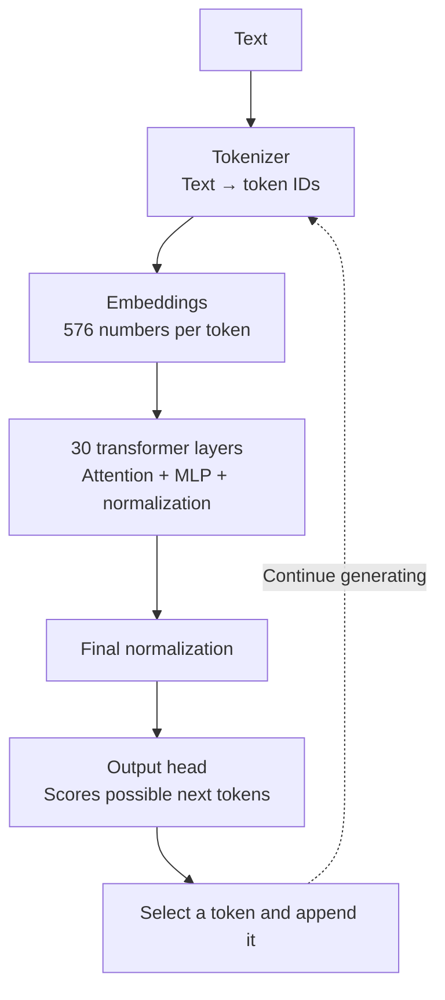

# Learning SmolLM2 fine-tuning

A hands-on project to understand **SmolLM2-135M-Instruct** and explore how LoRA changes its answers. The example topic is **King Dasharatha's family in the Ramayana**.

## Progress

- [x] Download the model.
- [x] Inspect its architecture, parameter count, names, and weight values.
- [x] Prepare 15 baseline questions and save the model's answers.
- [x] Create [12 training examples](data/iteration_1/training/examples.jsonl).
- [x] Create [15 test questions](data/iteration_1/evaluation/test_questions.jsonl) to check what the model learned, keeping them out of training.
- [x] Fine-tune with LoRA and inspect the adapter.
- [x] Compare base-model and adapter-enabled answers and [review the results](results/iteration_1/after_finetuning/comparison-20260927T203646-554996Z/evaluation.md).

## Key learnings

- **Model code** defines the structure and calculations.
- **Weights** are learned numbers used in those calculations. The downloaded model already contains trained weights.
- **A parameter** is one adjustable number. A weight table with 2 rows and 3 columns has 6 parameters.
- **Inference** generates answers using fixed weights. Different inputs produce different results through the same network.
- **Training** adjusts parameters using examples. Chatting with the model does not permanently teach it new facts.
- **LoRA** trains small additional weight matrices while keeping the base weights frozen in our planned setup.

## Architecture

A Llama-style, decoder-only Transformer predicts one token—a piece of text—at a time.



Attention connects relevant tokens; the MLP processes each token's representation. This is a simplified flow; shortcut connections and cached calculations are omitted.

| Property | Value |
|---|---:|
| Transformer layers | 30 |
| Hidden size | 576 |
| MLP intermediate size | 1,536 |
| Query / key-value heads per layer | 9 / 3 |
| Vocabulary | 49,152 tokens |
| Configured context limit | 8,192 tokens |
| Unique parameters | **134,515,008** |

### Parameter count

Count the entries in each weight table and add the unique parameters:

```text
Token embeddings: 49,152 × 576             28,311,552
30 transformer layers × 3,540,096         106,202,880
Final normalization                             576
                                         -----------
Total                                    134,515,008
```

Each layer has 884,736 attention parameters, 2,654,208 MLP parameters, and 1,152 normalization parameters. The output head shares the embedding weights, so they are counted only once. “135M” is the approximate model size.

## Project layout

```text
smollm-finetuning/
├── app/            # Streamlit chat interface
├── scripts/        # Training, practice checks, inspection, and comparison
├── data/
│   ├── iteration_1/         # Original completed experiment
│   │   ├── training/
│   │   │   └── examples.jsonl       # 12 examples
│   │   └── evaluation/
│   │       ├── baseline_questions.md
│   │       ├── test_questions.jsonl
│   │       └── test_answers.jsonl
│   ├── iteration_2/         # 42-example experiment
│       ├── training/
│       │   ├── examples.jsonl       # 42 examples
│       │   └── examples_draft.md   # Approved teaching examples
│       └── evaluation/
│           ├── practice_questions.jsonl    # 12 development checks
│           ├── practice_answers.jsonl
│           ├── final_test_questions.jsonl  # 12 reserved final checks
│           └── final_test_answers.jsonl
│   └── iteration_3/         # 238-example data-coverage experiment
│       ├── training/
│       │   ├── examples.jsonl
│       │   └── dataset_notes.json
│       └── evaluation/     # Same practice questions/answers as iteration 2
├── models/
│   ├── base/       # Original model: before fine-tuning
│   └── adapters/
│       ├── iteration_1/    # Original trained adapter, under its existing run ID
│       ├── iteration_2/    # Each run has adapter files and checkpoints/
│       └── iteration_3/
├── results/
│   ├── iteration_1/
│   │   ├── before_finetuning/  # Original model's answers
│   │   ├── training/           # Loss logs and weight checks
│   │   └── after_finetuning/   # Adapter answers and evaluations
│   ├── iteration_2/
│       ├── before_finetuning/
│       ├── training/           # New run logs and practice answers
│       └── after_finetuning/
│   └── iteration_3/        # Same before/training/after structure as needed
├── readme.md
└── requirements-ui.txt
```

## Run the project

GitHub contains the source code, training/evaluation data, and text experiment results. The local virtual environment, downloaded base model, and trained adapters/checkpoints are excluded by `.gitignore`; they remain on the original machine. A fresh clone does not include model weights and cannot run adapter comparisons until the required weights are available locally. Historical result paths record the original machine for provenance.

Run these commands from this directory with the project's virtual environment active and the model in `models/base/SmolLM2-135M-Instruct/`.

Scripts use **iteration 1** by default. Select `--iteration 2` or `--iteration 3` explicitly for that experiment's data, practice checks, adapter folder, and results. Questions and expected answers belong in `data/`; generated responses and scores belong in `results/`.

Historical result files are unchanged and retain paths and fingerprints recorded before the data, adapters, and results were reorganized. The original adapter is now under `models/adapters/iteration_1/`; its files are byte-for-byte unchanged. Scripts locate it by iteration and run ID rather than the historical path. The baseline Markdown's response link was adjusted for its new location; its questions and answer key are unchanged.

**Browser chat:**

```sh
python -m pip install -r requirements-ui.txt
python -m streamlit run app/streamlit_app.py --server.address 127.0.0.1 --browser.gatherUsageStats false
```

Open **http://localhost:8501**. Questions are independent by default, while earlier answers stay visible. Enable **Use conversation history** for follow-ups, or use **New chat** to clear the screen. Press Ctrl+C in the terminal to stop the server. Inference runs locally. Conversations are not saved to disk.

**Inspect sample weights:**

```sh
python scripts/inspect_weights.py
```

**Run the baseline again:**

```sh
python scripts/run_baseline.py
```

Each baseline run creates a new folder under `results/iteration_1/before_finetuning/` containing answers, exact prompts, and run settings.

**Train a LoRA adapter** (requires PEFT):

```sh
python scripts/train_lora.py
```

The defaults are 30 epochs, batch size 4, and learning rate 0.0005. Training starts a fresh adapter on the original base model, not on iteration 1's trained adapter. It verifies that every original weight is unchanged and saves under `models/adapters/iteration_<number>/<run-id>/`. Loss logs, settings, and verification results go under `results/iteration_<number>/training/<run-id>/`; new run IDs include the iteration. Add `--dry-run` to check one batch's gradients without updating weights or saving files. Decreasing training loss is not proof of success on new questions.

**Iteration 2 — check the setup before training:**

```sh
python scripts/train_lora.py --iteration 2 --check-data
python scripts/train_lora.py --iteration 2 --dry-run
```

`--check-data` loads only the tokenizer/configuration and checks the 42 training examples and 12 practice questions. `--dry-run` also loads the model and checks gradients, but takes no optimizer step and saves nothing. Neither reads the final test.

**Start iteration 2 training:**

```sh
python scripts/train_lora.py --iteration 2
```

This runs 330 updates at the defaults. Every five epochs and at the final epoch, it saves an adapter-only snapshot under `checkpoints/epoch_<number>/`, calculates practice answer-token loss without gradients, and generates all 12 practice answers independently. Expected answers are used for loss calculation, never included in generation prompts. Readable answers and raw outputs go under `results/iteration_<number>/training/<run-id>/practice/epoch_<number>/`; metrics go in `practice_metrics.jsonl`. Change the interval with `--checkpoint-every N`. Snapshots do not include optimizer state and are not training-resume checkpoints.

The run completes all requested epochs; there is no automatic early stopping. It nominates the checkpoint with the lowest practice answer-token loss (earlier checkpoint wins ties) and saves a copy at the run's adapter root. This is a proxy, not a correctness score: review the practice answers before final testing. Metadata records the selected epoch, loss, and whether it beat the initial practice loss. The final test is never read by training. Existing data, adapters, and results are not overwritten.

Inspect the newly saved adapter with `python scripts/inspect_trained_adapter.py --iteration 2` (add `--run RUN_ID` when that iteration has multiple completed runs).

To diagnose memorization separately from generalization, run `python scripts/diagnose_adapter.py --iteration 2 --run RUN_ID --epochs 10 30`. This generates answers to the exact training questions without providing their answers in the prompt. Records go under `results/iteration_2/diagnostics/`; exact-text-match counts are not semantic accuracy. No training or final testing occurs.

After training, we will load the same base model together with a LoRA adapter from `models/adapters/`, and save its answers under `results/iteration_<number>/after_finetuning/`. The adapter is an addition to the original model, not a second full model. The app currently uses only the original model.

**Compare the original model with the trained adapter:**

```sh
python scripts/compare_models.py
```

This asks the 15 baseline and 15 test questions independently of both configurations, using identical prompts and generation settings. It saves base-only answers under `results/iteration_<number>/before_finetuning/<comparison-id>/` and adapter-enabled answers plus `comparison.md` under `results/iteration_<number>/after_finetuning/<comparison-id>/`. Both sets are generated during the comparison; the earlier baseline is preserved. Answer keys are not sent to the model. Add `--run RUN_ID` if several trained adapters exist, or `--dry-run` to check one baseline question without saving results.

`compare_models.py --iteration 2` selects an iteration 2 adapter but defaults to the **iteration 1 development questions**. Use `--checkpoint EPOCH` to select a reviewed snapshot rather than the run-root loss nomination. `--question-set practice --evaluation-iteration 2` selects the common practice set. Final testing requires `--question-set final --evaluation-iteration 2 --confirm-final-test` and should happen only after checkpoint selection is frozen; never tune against its results.

## Training and test data

Iteration 1's 12 training examples teach parent–child relationships from [Valmiki Ramayana, Bala Kanda, Sarga 18](https://valmikiramayan.net/utf8/baala/sarga18/balaitrans18.htm). Each JSONL line contains a system instruction, user question, and correct assistant answer. The training script loads `data/iteration_<number>/training/examples.jsonl` for the selected iteration, uses the model's chat template, and calculates training loss on the assistant answer only.

The 15 additional test questions cover rephrasing, relationships, combining facts, counting, false assumptions, and insufficient information. [Expected answers](data/iteration_1/evaluation/test_answers.jsonl) are matched to questions by ID and used only for grading. The incomplete-record scenarios are invented exercises, not events from the Ramayana.

Iteration 2's [42 examples](data/iteration_2/training/examples.jsonl) retain the original 12 and add 30 approved examples addressing these gaps. Because iteration 1's failures informed those additions, its old tests are now development checks.

Iteration 3's [238 examples](data/iteration_3/training/examples.jsonl) retain those 42 and add 196 deterministic wording/relationship variations from the same four-prince family table. `scripts/build_training_variations.py` prints the reproducible dataset; it does not write files. These are additional phrasings and combinations, not independent new family facts. Iteration 3 uses the unchanged iteration 2 practice set and reserves the same iteration 2 final test. Its experimental training command is `python scripts/train_lora.py --iteration 3 --epochs 8 --learning-rate 0.0005 --checkpoint-every 1`.

Iteration 2 has [12 practice questions](data/iteration_2/evaluation/practice_questions.jsonl) with [expected answers](data/iteration_2/evaluation/practice_answers.jsonl) for checking progress and choosing a saved adapter. Its [12 final-test questions](data/iteration_2/evaluation/final_test_questions.jsonl) with [expected answers](data/iteration_2/evaluation/final_test_answers.jsonl) are reserved until training and checkpoint selection are finished. Each set has two questions per category: direct facts in new wording, relationships, combining facts, counting, false assumptions, and insufficient information. Neither set has been run.

The new questions are not exact copies of training, iteration 1 evaluation, or each other, but they deliberately overlap in facts and task types. This tests robustness on the same small family tree, not new subject knowledge or broad reasoning ability. Keep the final set fixed; do not use its results to select checkpoints or revise this iteration's training data. For the final comparison, run the base model and both adapters on that same set with identical generation settings.

Training and evaluation share family facts, but no exact questions. This small experiment tests how the model uses those facts; it does not establish broad Ramayana knowledge. Twelve examples may lead to memorization or overfitting.

Keep both practice and final-test questions out of gradient-based training; only practice results may guide training settings or checkpoint selection. Ask each question independently using the existing system instruction, without the answer key, previous answers, or extra family facts. Grade meaning, accept spelling variants and reordered lists, and record correct, partially correct, incorrect, or abstained answers, noting invented claims separately. Fully correct means answering every part requested without false additions; a matching name in an incorrect relationship does not count. The expected answers illustrate acceptable responses, not exact strings or mandatory extra explanations. For insufficient-information questions, explain the ambiguity and list alternatives when requested; this is correct, not abstention. Generic "I don't know" without a requested explanation is incomplete. A correct final answer to a combining-facts question does not establish the model's internal reasoning process.

## Baseline and evaluation

The baseline contains 15 questions asked independently, without providing the answer key. The model made factual errors; its original responses are preserved for comparison after fine-tuning.

- [Questions and answer key](data/iteration_1/evaluation/baseline_questions.md)
- [Saved baseline responses](results/iteration_1/before_finetuning/baseline-20260927T170448-704325Z/responses.md)
- [Exact prompts and raw outputs](results/iteration_1/before_finetuning/baseline-20260927T170448-704325Z/responses.jsonl)
- [Checkpoint and generation settings](results/iteration_1/before_finetuning/baseline-20260927T170448-704325Z/metadata.json)

Keep evaluation prompts and generation settings consistent before and after training. Compare memorization, rephrasing, generalization, reasoning, and invented claims. The model may already know some Ramayana facts, which is why recording a baseline matters.

For the LoRA experiment, verify that base weights stay unchanged while adapter weights change, before any adapter merging.
